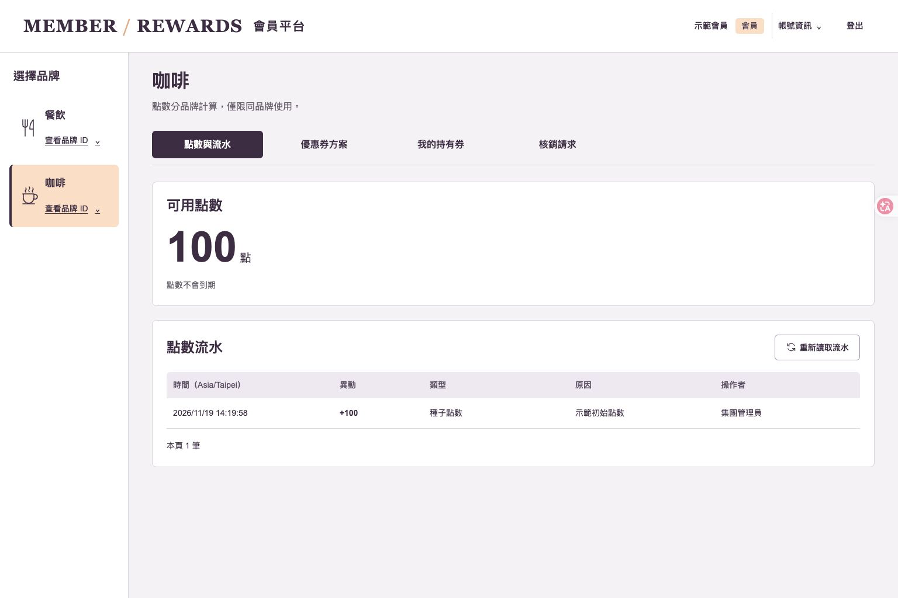

# 多品牌會員、點數與優惠券管理平台

一套可在本機操作的多品牌會員平台。同一會員帳號可查看咖啡與餐飲品牌，各品牌點數獨立累積與兌換。管理員提出用券請求後，由原持有會員確認，才完成核銷。



## 主要功能

- **會員與品牌權限**：公開註冊只建立會員。集團管理員可新增與改名品牌；品牌管理員僅操作獲授權品牌。後台以完整會員編號查詢，不提供會員目錄。
- **點數與流水**：點數不會到期，不可跨品牌使用。管理員可加點及整筆撤回錯誤人工加點；原紀錄、原因、操作者及反向流水均保留，餘額不足時不能撤回。
- **優惠券方案與兌換**：方案建立即上架，條件固定，可單向停發。會員花費同品牌點數兌換，扣點、流水與發券一併成功或回滾。已發出的券保留原條件，到期不退點。
- **原會員確認核銷**：管理員輸入完整券碼提出請求，原會員核對品牌、優惠券及發起管理員後確認即完成。取消、拒絕及逾期不消耗券，核銷不再扣點。
- **重送與資料保存**：同一操作識別及內容重試取回原結果。正常啟停保留帳務、券、操作結果與請求原期限；本機重設另有明確確認。

## 技術與架構

| 層面 | 技術 |
| --- | --- |
| 前端 | Next.js 16、React 19、TypeScript、CSS |
| 後端 | Node.js 24、NestJS 11、Express 5 |
| 資料存取 | PostgreSQL 17、Prisma 7、SQL 遷移與交易 |
| 登入與授權 | JWT、HttpOnly Cookie、持久工作階段、角色及品牌範圍 |
| 本機環境與測試 | Docker Compose、Jest、Supertest、Playwright／Chrome |

NestJS 在同一 HTTP 入口提供 Next.js 網頁與 API。採 DDD-Lite 依品牌、點數、優惠券與核銷用例分工：前端 [page.tsx](frontend/app/page.tsx) 管理登入工作階段，[brands.tsx](frontend/app/brands.tsx) 管理品牌與功能切換，[points.tsx](frontend/app/points.tsx)、[offers.tsx](frontend/app/offers.tsx)、[vouchers.tsx](frontend/app/vouchers.tsx) 與 [redemptions.tsx](frontend/app/redemptions.tsx) 各自處理對應操作、草稿及恢復。共用 [身分 DTO](frontend/app/identity.ts) 與各功能的回應驗證明定 HTTP 傳輸欄位；[request.tsx](frontend/app/request.tsx) 處理傳輸與身分比對，前端不引用資料庫模型。

伺服器再次檢查目前身分、授權、期限及資源歸屬。PostgreSQL 交易、列鎖、約束與冪等操作結果共同維持點數、流水、持有券及核銷請求一致。等待會員確認期間不持有交易鎖。

核銷查驗不揭露會員個資，請求只供原會員及原發起管理員讀回。工作階段固定 30 分鐘，登出即撤銷；不同帳號不共用前端畫面資料。[完整技術、功能與測試指南](docs/project-guide.md)

## 本機啟動、停止與重設

以下指令均在專案根目錄執行。需要本機 Docker 與 Docker Compose 2.24.4 以上；主機不需另裝 Node.js 或 PostgreSQL。首次建置需要網路下載映像與套件。

### 啟動與登入

```sh
docker compose up -d --build --wait
```

開啟 [會員平台](http://membership-rewards.localhost:18441)。請使用此主機名稱，服務會核對精確 Host 與寫入 Origin；入口僅綁定 `127.0.0.1`，資料庫留在 Compose 網路。

在自己的終端讀取本機產生的示範密碼，勿將內容提交或公開：

```sh
docker compose exec app cat /run/membership-app/demo-passwords.json
```

| 帳號 | 角色 | 品牌範圍 |
| --- | --- | --- |
| `demo_member` | 會員 | 自己的分品牌點數與優惠券 |
| `group_admin` | 集團管理員 | 全部品牌，含新增品牌 |
| `brand_admin_a` | 品牌管理員 | 預載咖啡品牌 |
| `brand_admin_b` | 品牌管理員 | 預載餐飲品牌 |

### 停止與再啟動

```sh
docker compose down
docker compose up -d --build --wait
```

`down` 移除本案容器及網路，保留 PostgreSQL 與密鑰資料卷。再次啟動沿用既有資料及示範密碼，待確認請求仍使用原截止時間。備份請一起保存 `postgres`、`db-secrets` 及 `app-secrets`；應用密鑰缺失或配對不符時初始化會停止，應還原原 `app-secrets` 後再啟動。

### 重設本機展示資料

```sh
sh docker/reset.sh
```

核對畫面中的 Docker context、專案路徑、連接埠及三個目標資料卷後，輸入完整確認字串 **`membership-rewards`**。輸入其他文字或按 Ctrl+D 取消。

重設會停止 HTTP 入口與 PostgreSQL，以目前程式碼建置，移除本案資料卷並重新套用遷移及初始化。全部舊帳號與登入、品牌與授權、點數帳務與流水、方案與停發紀錄、持有券與券碼、核銷請求及操作結果都會失效；沒有備份就無法復原。完成後會產生新的示範密碼，請重新執行上方讀取密碼命令並登入。

請在資料卷建立時的原專案路徑及本機 Unix socket Docker context 操作；無法確認歸屬的舊資料卷會保留並拒絕重設。重設期間不要另開 Compose 啟停或測試。指令只在應用就緒後回報成功；報錯時先排除原因，再重試重設。若已清除完成、只需重試初始化，使用啟動命令。若強制終止留下 `/tmp/membership-rewards-reset.lock`，先確認沒有重設仍在執行，再以 `rmdir /tmp/membership-rewards-reset.lock` 移除空鎖目錄。

## 手動驗證

先準備兩個獨立瀏覽器工作階段，例如一般視窗操作會員、無痕視窗操作管理員。同一側換帳號時先登出。

1. **建立會員並加點。** 註冊新會員並登入，記下完整會員編號。管理員以 `brand_admin_a` 登入、選咖啡品牌，輸入該編號查詢，加 100 點並填寫原因。會員應看到咖啡 100 點、餐飲 0 點；預載 `demo_member` 另有咖啡 100 點種子流水。
2. **上架方案並兌換。** 管理員在咖啡建立需 80 點的方案，輸入名稱與純文字優惠內容，再以日期時間選擇器選取台北時間（`Asia/Taipei`）的開始與截止。要立即兌換，開始須在目前以前、截止須在未來。會員兌換後查到一張持有券、−80 點流水及餘額 20 點。時間以 `Asia/Taipei` 顯示。
3. **原會員確認核銷。** 管理員輸入完整券碼提出請求並記下請求 ID。原會員核對品牌、優惠券、發起者及期限後確認。券應為「已核銷」，管理員用原請求 ID 查到「已完成」；餘額仍為 20 點，沒有新增核銷扣點。請求等待五分鐘或券截止時間，以較早者為準。
4. **查核其他操作。** 可另加 10 點再整筆撤回，核對關聯的 −10 點流水、原因與操作者，餘額回到 20 點。方案停發後不得新兌換，既有券仍按原期限使用；取消、拒絕、逾期不消耗券。集團管理員可新增品牌或改名，改名不改品牌 ID，同名時以 ID 區別。
5. **核對保存。** 停止再啟動服務，確認原資料與仍有效的登入可讀回；已登出的登入不恢復，待確認請求不延長。管理員登出不自動取消請求，原會員確認時仍檢查發起者目前授權。

操作結果待確認時，保留原瀏覽器網站資料，以原帳號回到同品牌及同會員的操作頁，按「重試同一次…」；不得把重送當成另一筆加點或兌換。重試提出核銷需重新輸入原券碼，券碼不存入待確認紀錄。上架、停發或品牌寫入不確定時，先重新讀取清單核對，再決定新操作。兌換需要瀏覽器支援 Web Locks、Web Crypto 及網站儲存。

## 隔離測試與驗證紀錄

以下後端測試使用獨立 `membership-rewards-test`、PostgreSQL 與資料卷，請依序執行，每次只跑一組：

```sh
docker compose -p membership-rewards-test -f compose.yaml -f compose.test.yaml run --build --rm backend-checks
```

需要瀏覽器驗證時，啟動測試入口並取得測試密碼：

```sh
docker compose -p membership-rewards-test -f compose.yaml -f compose.test.yaml up -d --build --wait app
docker compose -p membership-rewards-test -f compose.yaml -f compose.test.yaml exec app cat /run/membership-app/demo-passwords.json
```

開啟 [隔離測試站](http://membership-rewards-test.localhost:18442)，依上方流程操作。重設演練只在此站執行 `sh docker/reset.sh --test`，先用錯誤名稱取消並確認資料保留，再輸入 **`membership-rewards-test`** 確認清除。重設後用新密碼登入，確認舊會員、券碼及請求 ID 查不到。

確定測試資料可清除後，以下命令會刪除測試專案的容器、資料卷、帳號、登入及密鑰：

```sh
docker compose -p membership-rewards-test -f compose.yaml -f compose.test.yaml down --volumes
```

2026-11-19 本次介面改版驗證：

- 後端自動測試 7 套、136 項通過，0 失敗、0 跳過；Node.js 24 型別檢查與正式建置通過，Docker 最終應用建置完成且服務健康。
- Chrome 真實介面操作完成 117 項斷言，涵蓋註冊登入、品牌操作權限、加點／撤回、方案／兌換／停發、雙方核銷確認／取消／拒絕、斷線後同次操作恢復，以及 390px 與 800／1100px 斷點兩側的響應式排版、長文和鍵盤 Enter 操作。這是人工瀏覽器操作與斷言紀錄，不是自動測試套件。
- 已留存的主控台紀錄有 28 筆 Chrome 擴充套件錯誤，未見應用來源錯誤；舊分頁因休眠中斷，紀錄未完整留存。本輪未重跑下列歷史 Docker 黑箱 11 項，也未驗證其他瀏覽器或主機平台。

v0.1 歷史驗收為後端 7 套 136 項、Chrome 雙角色 7 組及 Docker 黑箱 11 項，全數通過、無跳過。這是既有交付紀錄，不能當作本次介面改版的新驗證。

歷史實測環境為 macOS 27.2.1 arm64、Linux arm64 容器、Docker Engine 29.8.2、Docker Compose 5.5.0、Chrome 156.0.8078.82；Node.js 24.22.2、PostgreSQL 17.9、NestJS 11.2.9、Prisma 7.10.1、Next.js 16.4.6、React 19.3.1。其他主機平台與瀏覽器尚待驗證。[專案與測試指南](docs/project-guide.md)
